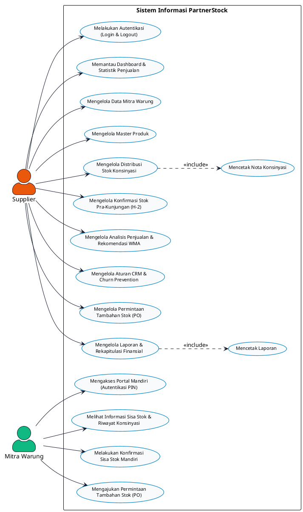
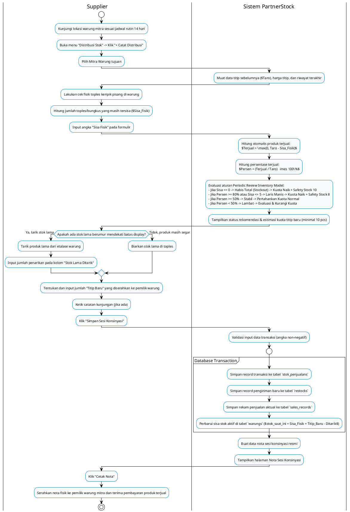
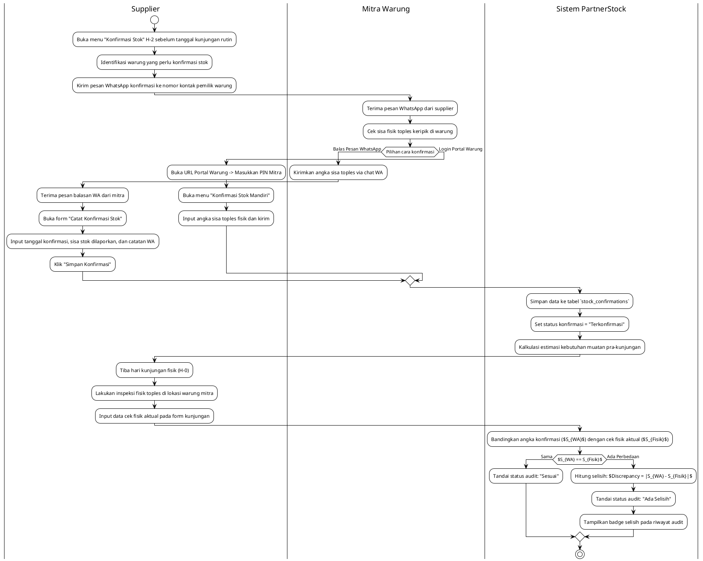
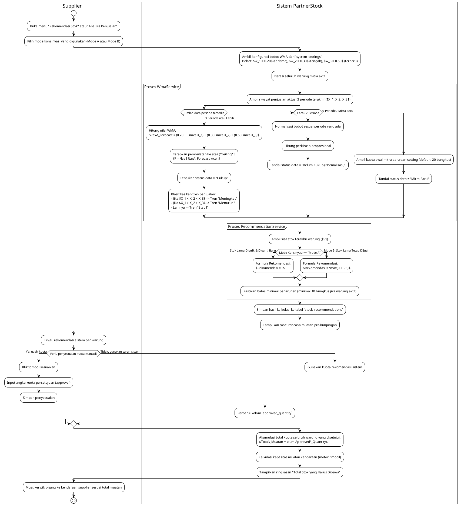
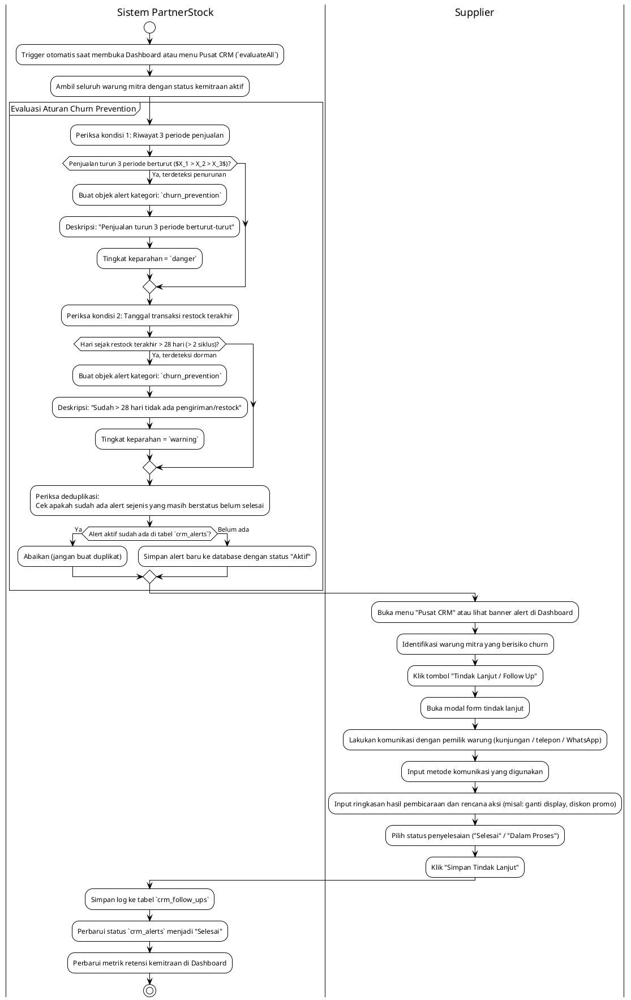
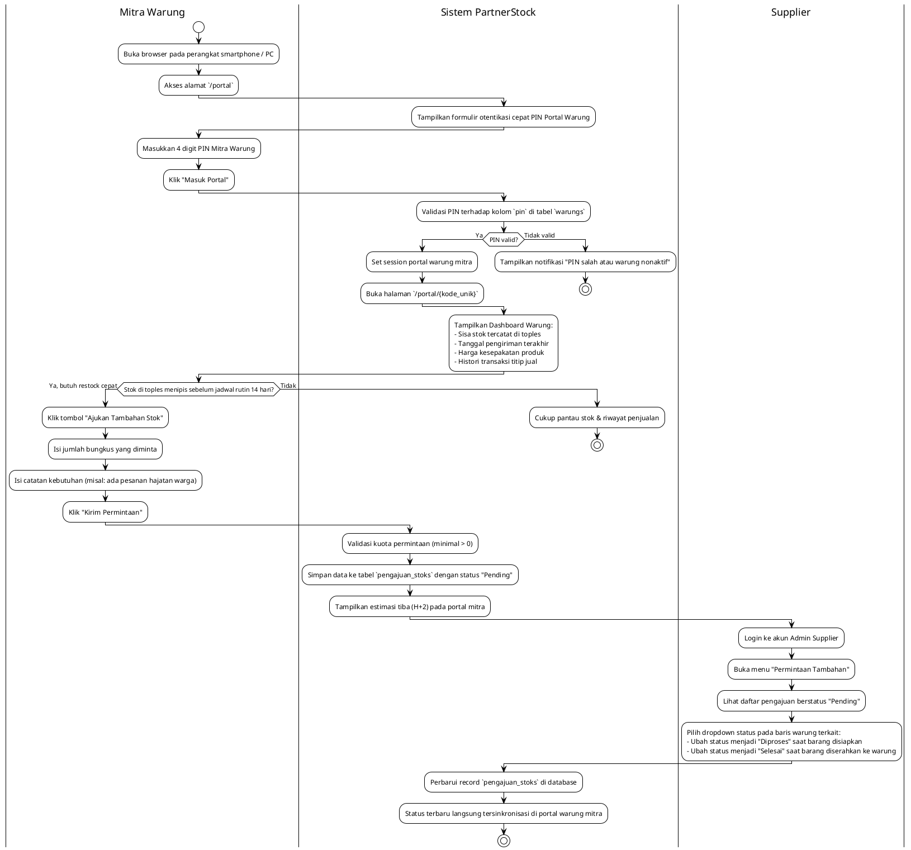
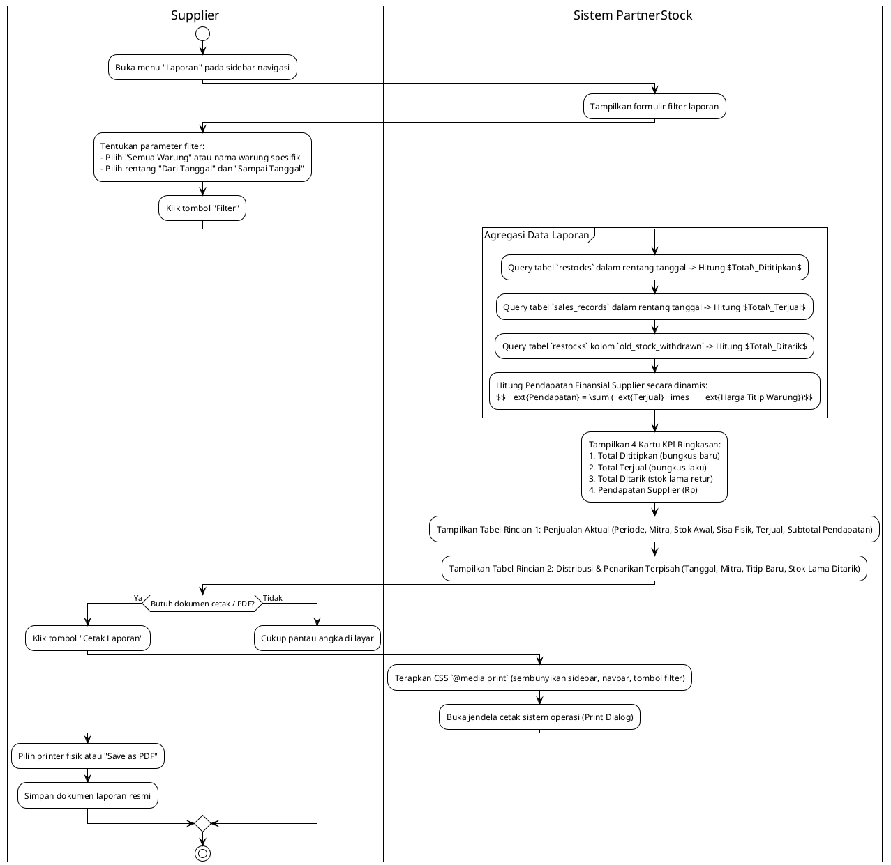

# 📊 Dokumentasi Diagram UML Lengkap - Sistem PartnerStock
### Use Case Diagram, Activity Diagrams, & Class Diagram Berbasis PlantUML

Dokumen ini memuat diagram pemodelan berorientasi objek (*Object-Oriented Analysis and Design*) menggunakan sintaks **PlantUML** standar untuk seluruh alur bisnis, aktor, modul pekerjaan, dan arsitektur data pada platform **PartnerStock (Sistem Distribusi & Konsinyasi B2B)**.

---

## 📑 Daftar Isi
1. [Use Case Diagram (Ringkas & Standar)](#1-use-case-diagram-ringkas--standar)
2. [Activity Diagrams (Alur Kerja Seluruh Proses Bisnis)](#2-activity-diagrams-seluruh-alur-pekerjaan)
   - [Activity 1: Siklus Kunjungan Konsinyasi Fisik & Pencatatan Nota](#activity-1-siklus-distribusi-konsinyasi-fisik--pencatatan-nota)
   - [Activity 2: Konfirmasi Stok Pra-Kunjungan (H-2) & Verifikasi Selisih](#activity-2-konfirmasi-stok-pra-kunjungan-h-2--verifikasi-selisih)
   - [Activity 3: Peramalan Stok Sistem (WMA 3 Periode) & Penyesuaian Muatan](#activity-3-peramalan-stok-sistem-wma-3-periode--penyesuaian-muatan)
   - [Activity 4: Evaluasi Otomatis CRM & Tindak Lanjut Churn Prevention](#activity-4-evaluasi-otomatis-crm--tindak-lanjut-churn-prevention)
   - [Activity 5: Portal Mandiri Warung & Pengajuan Restock (PO)](#activity-5-portal-mandiri-mitra-warung--pengajuan-restock-po)
   - [Activity 6: Rekapitulasi Laporan & Kalkulasi Finansial](#activity-6-rekapitulasi-laporan--kalkulasi-finansial)
3. [Class Diagram (Arsitektur Model, Controller, Service & Relasi)](#3-class-diagram-komprehensif)
4. [Entity Relationship Diagram (ERD Relasi Basis Data)](#4-entity-relationship-diagram-erd-relasi-basis-data)
5. [Petunjuk Render PlantUML](#5-petunjuk-render-plantuml)

---

## 1. Use Case Diagram (Ringkas & Standar)

Diagram Use Case ini memodelkan kebutuhan fungsional sistem pada tingkat tinggi (*high-level*) yang berfokus pada aksi kerja utama (**Mengelola / Memantau / Mengajukan**) dengan **2 Aktor Pengguna**:
1. **Supplier**: Mengelola seluruh aktivitas operasional kemitraan, master data, distribusi fisik, peramalan restock, CRM, dan rekapitulasi.
2. **Mitra Warung**: Mengakses portal mandiri untuk memantau stok toples konsinyasi, melakukan konfirmasi, dan mengajukan pesanan restock (PO).



---

## 2. Activity Diagrams (Seluruh Alur Pekerjaan)

### Activity 1: Siklus Distribusi Konsinyasi Fisik & Pencatatan Nota
Diagram ini memodelkan pekerjaan rutin kunjungan supplier ke warung mitra (verifikasi toples, kalkulasi terjual, penarikan stok lama, dan cetak bukti nota transaksi).



---

### Activity 2: Konfirmasi Stok Pra-Kunjungan (H-2) & Verifikasi Selisih
Diagram ini memodelkan alur konfirmasi stok H-2 sebelum kunjungan fisik supplier untuk mendeteksi selisih stok lebih awal.



---

### Activity 3: Peramalan Stok Sistem (WMA 3 Periode) & Penyesuaian Muatan
Diagram ini memodelkan pekerjaan sistem dalam menghitung ramalan kebutuhan produk berdasarkan bobot historis penjualan dan perencanaan muatan kendaraan.



---

### Activity 4: Evaluasi Otomatis CRM & Tindak Lanjut Churn Prevention
Diagram ini memodelkan pekerjaan pengawasan kemitraan, deteksi anomali penjualan atau masa dorman, serta pencatatan log tindakan pembinaan supplier.



---

### Activity 5: Portal Mandiri Mitra Warung & Pengajuan Restock (PO)
Diagram ini memodelkan alur interaksi pemilik warung mitra saat mengakses portal mandiri via PIN dan mengajukan pesanan restock di luar siklus rutin.



---

### Activity 6: Rekapitulasi Laporan & Kalkulasi Finansial
Diagram ini memodelkan pekerjaan pembuatan laporan rekapitulasi penjualan aktual, penarikan stok lama, dan penghitungan pendapatan supplier.



---

## 3. Class Diagram Komprehensif

Class Diagram di bawah ini memodelkan seluruh arsitektur kode sumber platform **PartnerStock**, meliputi:
- **Lapisan Model Eloquent (13 Entitas)** dengan atribut, tipe data, dan relasi *Foreign Key* / *Association*.
- **Lapisan Service Logika Bisnis** (`WmaService`, `RecommendationService`, `CrmService`).
- **Lapisan Controller (MVC)** pengatur *routing* dan aliran data.

```plantuml
@startuml class_diagram_partnerstock
!theme plain
skinparam backgroundColor #FFFFFF
skinparam handwritten false
skinparam shadowing false
skinparam classAttributeIconSize 0

skinparam class {
    BackgroundColor #FFFFFF
    BorderColor #0F172A
    FontName "Plus Jakarta Sans", Arial, sans-serif
    FontSize 10
}

package "App\\Models (Domain Data Entities)" {

    class User {
        +id: int
        +name: string
        +email: string
        +password: string
        +role: string
        +is_active: bool
        +created_at: timestamp
        +updated_at: timestamp
        --
        +supplier(): BelongsTo
        +warung(): HasOne
    }

    class Supplier {
        +id: int
        +user_id: int
        +business_name: string
        +phone: string
        +address: text
        +created_at: timestamp
        +updated_at: timestamp
        --
        +user(): BelongsTo
        +products(): HasMany
        +warungs(): HasMany
    }

    class Warung {
        +id: int
        +supplier_id: int
        +user_id: int
        +nama_warung: string
        +nama_pemilik: string
        +alamat: text
        +kontak: string
        +kode_unik: string
        +pin: string
        +stok_saat_ini: int
        +harga_titip: int
        +harga_jual: int
        +partnership_status: string
        +delivery_interval_days: int
        +is_aktif: bool
        +deleted_at: timestamp
        --
        +supplier(): BelongsTo
        +user(): BelongsTo
        +stokPenjualans(): HasMany
        +pengajuanStoks(): HasMany
        +stockConfirmations(): HasMany
        +salesRecords(): HasMany
        +restocks(): HasMany
        +stockRequests(): HasMany
        +stockRecommendations(): HasMany
        +crmAlerts(): HasMany
        +crmFollowUps(): HasMany
        +getLatestStockConfirmationAttribute(): StockConfirmation
        +getNeedsStockConfirmationAttribute(): bool
    }

    class Product {
        +id: int
        +supplier_id: int
        +product_code: string
        +name: string
        +unit: string
        +agreed_price: int
        +cost_price: int
        +is_active: bool
        --
        +supplier(): BelongsTo
    }

    class StokPenjualan {
        +id: int
        +warung_id: int
        +tipe_transaksi: string
        +tanggal_titip: date
        +jumlah_titip: int
        +tanggal_cek: date
        +stok_sebelumnya: int
        +sisa_fisik: int
        +jumlah_laku: int
        +sisa_stok: int
        +total_pendapatan: int
        +catatan: text
        +keputusan_stok: string
        --
        +warung(): BelongsTo
        +{static} hitungKeputusan(taro: int, sisa: int, siklus: int): array
        +getSisaFisikAttribute(value): int
    }

    class PengajuanStok {
        +id: int
        +warung_id: int
        +tanggal_pengajuan: date
        +jumlah_diminta: int
        +status: string
        +catatan: text
        +catatan_pemasok: text
        +tanggal_diproses: datetime
        --
        +warung(): BelongsTo
        +getEstimasiTibaAttribute(): Carbon
        +getStatusLabelAttribute(): string
        +getStatusBadgeClassAttribute(): string
    }

    class StockConfirmation {
        +id: int
        +warung_id: int
        +confirmation_date: date
        +reported_remaining_stock: int
        +notes: text
        +status: string
        --
        +warung(): BelongsTo
    }

    class SalesRecord {
        +id: int
        +warung_id: int
        +product_id: int
        +period_start: date
        +period_end: date
        +opening_stock: int
        +remaining_stock: int
        +sold_quantity: int
        +notes: text
        --
        +warung(): BelongsTo
        +product(): BelongsTo
    }

    class Restock {
        +id: int
        +warung_id: int
        +product_id: int
        +distribution_date: date
        +quantity_delivered: int
        +old_stock_withdrawn: int
        +notes: text
        --
        +warung(): BelongsTo
        +product(): BelongsTo
    }

    class StockRecommendation {
        +id: int
        +warung_id: int
        +calculation_date: date
        +wma_forecast: float
        +recommended_quantity: int
        +approved_quantity: int
        +consignment_mode: string
        +status: string
        +explanation: text
        --
        +warung(): BelongsTo
    }

    class CrmAlert {
        +id: int
        +warung_id: int
        +category: string
        +title: string
        +description: text
        +severity: string
        +status: string
        +dedup_hash: string
        --
        +warung(): BelongsTo
        +followUps(): HasMany
    }

    class CrmFollowUp {
        +id: int
        +crm_alert_id: int
        +warung_id: int
        +follow_up_date: date
        +contact_method: string
        +communication_result: text
        +action_plan: text
        --
        +crmAlert(): BelongsTo
        +warung(): BelongsTo
    }

    class SystemSetting {
        +id: int
        +key: string
        +value: text
        --
        +{static} get(key: string, default: any): any
        +{static} set(key: string, value: any): SystemSetting
    }
}

package "App\\Services (Business Logic Engine)" {

    class WmaService {
        +getWeights(): array
        +calculate(salesValues: array, customWeights: array): array
        +calculateForWarung(warung: Warung): array
    }

    class RecommendationService {
        -wmaService: WmaService
        --
        +getDefaultConsignmentMode(): string
        +getRecommendationForWarung(warung: Warung, mode: string): array
        +getRecommendationsForAllWarungs(mode: string): array
        +calculateVehicleLoad(recommendations: array): array
    }

    class CrmService {
        -wmaService: WmaService
        -recService: RecommendationService
        --
        +evaluateAll(supplierId: int): array
        +evaluateWarung(warung: Warung): array
        -generateDedupHash(warungId: int, category: string, sub: string): string
        +recordFollowUp(alert: CrmAlert, data: array): CrmFollowUp
    }
}

package "App\\Http\\Controllers (Application Web Layer)" {

    class AuthController {
        +showLogin(): View
        +login(request: Request): RedirectResponse
        +loginDemo(): RedirectResponse
        +logout(request: Request): RedirectResponse
    }

    class DashboardController {
        -crmService: CrmService
        -recService: RecommendationService
        -wmaService: WmaService
        --
        +index(): View
    }

    class WarungController {
        +index(request: Request): View
        +create(): View
        +store(request: Request): RedirectResponse
        +edit(warung: Warung): View
        +update(request: Request, warung: Warung): RedirectResponse
        +destroy(warung: Warung): RedirectResponse
    }

    class KunjunganController {
        +index(request: Request): View
        +create(): View
        +store(request: Request): RedirectResponse
        +nota(id: int): View
    }

    class PengajuanAdminController {
        +index(request: Request): View
        +updateStatus(request: Request, id: int): RedirectResponse
    }

    class ReportController {
        +index(request: Request): View
    }

    class WarungPortalController {
        +index(): View
        +authByPin(request: Request): RedirectResponse
        +show(kode_unik: string): View
        +submitKonfirmasi(request: Request, kode_unik: string): RedirectResponse
        +submitPengajuan(request: Request, kode_unik: string): RedirectResponse
        +logout(): RedirectResponse
    }
}

' Hubungan Antar Model (Data Relational Structure)
User "1" *-- "0..1" Supplier : owns
User "1" *-- "0..1" Warung : links to
Supplier "1" *-- "0..*" Warung : manages
Supplier "1" *-- "0..*" Product : manufactures
Warung "1" *-- "0..*" StokPenjualan : records
Warung "1" *-- "0..*" PengajuanStok : requests
Warung "1" *-- "0..*" StockConfirmation : confirms
Warung "1" *-- "0..*" SalesRecord : sales history
Warung "1" *-- "0..*" Restock : deliveries
Warung "1" *-- "0..*" StockRecommendation : forecasts
Warung "1" *-- "0..*" CrmAlert : alerts
Warung "1" *-- "0..*" CrmFollowUp : follow ups
CrmAlert "1" *-- "0..*" CrmFollowUp : logs

Product "1" -- "0..*" SalesRecord : references
Product "1" -- "0..*" Restock : references

' Dependensi Service Layer
RecommendationService ..> WmaService : uses
CrmService ..> WmaService : uses
CrmService ..> RecommendationService : uses
RecommendationService ..> Warung : evaluates
WmaService ..> Warung : evaluates
CrmService ..> CrmAlert : generates
CrmService ..> CrmFollowUp : stores

' Dependensi Controller -> Service / Model
DashboardController ..> CrmService : invokes evaluateAll()
DashboardController ..> RecommendationService : queries
DashboardController ..> Warung : queries
KunjunganController ..> StokPenjualan : creates
KunjunganController ..> Restock : creates
KunjunganController ..> SalesRecord : creates
KunjunganController ..> Warung : updates stock
WarungPortalController ..> Warung : authenticates PIN
WarungPortalController ..> PengajuanStok : stores PO
WarungPortalController ..> StockConfirmation : stores confirmation
PengajuanAdminController ..> PengajuanStok : updates status
ReportController ..> Restock : aggregates
ReportController ..> SalesRecord : aggregates

@enduml
```



---

## 4. Entity Relationship Diagram (ERD Relasi Basis Data)

Diagram ERD (*Entity-Relationship Diagram*) di bawah ini memodelkan struktur fisik & konseptual basis data **PartnerStock (PostgreSQL: `konsinyasi_pisang`)** menggunakan notasi resmi **Crow's Foot (IE Notation)**.

> [!NOTE]
> **Kaidah Standar Akademik**: Tabel bawaan *runtime framework* (`cache`, `cache_locks`, `jobs`, `job_batches`, `failed_jobs`, `sessions`, `password_reset_tokens`, `migrations`) **dikecualikan dari ERD**. Diagram ini murni menyajikan **13 Entitas Domain Bisnis Konsinyasi & CRM**, atribut kunci (*Primary Key & Foreign Key*), serta kardinalitas relasinya secara presisi.

```plantuml
@startuml erd_partnerstock
!theme plain
skinparam backgroundColor #FFFFFF
skinparam shadowing false
skinparam linetype ortho
skinparam roundcorner 5

skinparam entity {
    BackgroundColor #FFFFFF
    BorderColor #0F172A
    FontName "Plus Jakarta Sans", Arial, sans-serif
    FontSize 10
    HeaderBackgroundColor #F1F5F9
}

entity "users" as users {
    * id : BIGINT <<PK>>
    --
    * name : VARCHAR(255)
    * email : VARCHAR(255) <<UNIQUE>>
    * password : VARCHAR(255)
    * role : VARCHAR(50) [supplier / mitra]
    * is_active : BOOLEAN
    created_at : TIMESTAMP
    updated_at : TIMESTAMP
}

entity "suppliers" as suppliers {
    * id : BIGINT <<PK>>
    --
    * user_id : BIGINT <<FK>>
    * business_name : VARCHAR(255)
    phone : VARCHAR(50)
    address : TEXT
    created_at : TIMESTAMP
    updated_at : TIMESTAMP
}

entity "warungs" as warungs {
    * id : BIGINT <<PK>>
    --
    * supplier_id : BIGINT <<FK>>
    user_id : BIGINT <<FK>>
    * nama_warung : VARCHAR(255)
    nama_pemilik : VARCHAR(255)
    alamat : TEXT
    kontak : VARCHAR(50)
    * kode_unik : VARCHAR(50) <<UNIQUE>>
    * pin : VARCHAR(10)
    stok_saat_ini : INT
    harga_titip : INT
    harga_jual : INT
    partnership_status : VARCHAR(50) [aktif / nonaktif]
    delivery_interval_days : INT
    partnership_start_date : DATE
    is_aktif : BOOLEAN
    created_at : TIMESTAMP
    updated_at : TIMESTAMP
    deleted_at : TIMESTAMP
}

entity "products" as products {
    * id : BIGINT <<PK>>
    --
    * supplier_id : BIGINT <<FK>>
    * product_code : VARCHAR(50)
    * name : VARCHAR(255)
    unit : VARCHAR(50)
    agreed_price : DECIMAL(12,2)
    cost_price : DECIMAL(12,2)
    is_active : BOOLEAN
    created_at : TIMESTAMP
    updated_at : TIMESTAMP
}

entity "stok_penjualans" as stok_penjualans {
    * id : BIGINT <<PK>>
    --
    * warung_id : BIGINT <<FK>>
    tipe_transaksi : VARCHAR(50) [titip_awal / kunjungan]
    tanggal_titip : DATE
    jumlah_titip : INT
    tanggal_cek : DATE
    stok_sebelumnya : INT
    sisa_fisik : INT
    jumlah_laku : INT
    sisa_stok : INT
    total_pendapatan : INT
    catatan : TEXT
    keputusan_stok : VARCHAR(50)
    created_at : TIMESTAMP
    updated_at : TIMESTAMP
}

entity "pengajuan_stoks" as pengajuan_stoks {
    * id : BIGINT <<PK>>
    --
    * warung_id : BIGINT <<FK>>
    tanggal_pengajuan : DATE
    jumlah_diminta : INT
    status : VARCHAR(50) [pending / diproses / selesai / ditolak]
    catatan : TEXT
    catatan_pemasok : TEXT
    tanggal_diproses : TIMESTAMP
    created_at : TIMESTAMP
    updated_at : TIMESTAMP
}

entity "stock_confirmations" as stock_confirmations {
    * id : BIGINT <<PK>>
    --
    * supplier_id : BIGINT <<FK>>
    * warung_id : BIGINT <<FK>>
    confirmation_date : DATE
    reported_remaining_stock : INT
    physically_checked_stock : INT
    data_status : VARCHAR(50) [menunggu_pemeriksaan / sesuai / selisih]
    notes : TEXT
    created_at : TIMESTAMP
    updated_at : TIMESTAMP
}

entity "sales_records" as sales_records {
    * id : BIGINT <<PK>>
    --
    * supplier_id : BIGINT <<FK>>
    * warung_id : BIGINT <<FK>>
    product_id : BIGINT <<FK>>
    period_start : DATE
    period_end : DATE
    distributed_quantity : INT
    opening_stock : INT
    remaining_stock : INT
    sold_quantity : INT
    verified_at : TIMESTAMP
    created_at : TIMESTAMP
    updated_at : TIMESTAMP
}

entity "restocks" as restocks {
    * id : BIGINT <<PK>>
    --
    * supplier_id : BIGINT <<FK>>
    * warung_id : BIGINT <<FK>>
    product_id : BIGINT <<FK>>
    distribution_date : DATE
    quantity_delivered : INT
    old_stock_withdrawn : INT
    approved_quantity : INT
    notes : TEXT
    created_at : TIMESTAMP
    updated_at : TIMESTAMP
}

entity "stock_recommendations" as stock_recommendations {
    * id : BIGINT <<PK>>
    --
    * supplier_id : BIGINT <<FK>>
    * warung_id : BIGINT <<FK>>
    product_id : BIGINT <<FK>>
    stock_confirmation_id : BIGINT <<FK>>
    calculation_date : DATE
    forecast_quantity : DECIMAL(8,2)
    recommended_quantity : INT
    approved_quantity : INT
    consignment_mode : VARCHAR(10) [A / B]
    data_status : VARCHAR(50) [cukup / belum_cukup / perlu_konfirmasi]
    source_periods : JSON
    weights_used : JSON
    adjustment_reason : TEXT
    created_at : TIMESTAMP
    updated_at : TIMESTAMP
}

entity "crm_alerts" as crm_alerts {
    * id : BIGINT <<PK>>
    --
    * supplier_id : BIGINT <<FK>>
    * warung_id : BIGINT <<FK>>
    category : VARCHAR(100) [churn_prevention / data_mining / reorder]
    trigger_type : VARCHAR(100)
    trigger_period : VARCHAR(50)
    description : TEXT
    evidence_data : JSON
    status : VARCHAR(50) [perlu_ditinjau / perlu_dihubungi / sudah_dihubungi / selesai]
    resolved_at : TIMESTAMP
    created_at : TIMESTAMP
    updated_at : TIMESTAMP
}

entity "crm_follow_ups" as crm_follow_ups {
    * id : BIGINT <<PK>>
    --
    * crm_alert_id : BIGINT <<FK>>
    * supplier_id : BIGINT <<FK>>
    * warung_id : BIGINT <<FK>>
    follow_up_date : DATE
    contact_method : VARCHAR(50) [whatsapp / telepon / kunjungan_langsung]
    result_notes : TEXT
    next_action : TEXT
    status : VARCHAR(50) [selesai / dalam_proses]
    created_at : TIMESTAMP
    updated_at : TIMESTAMP
}

entity "system_settings" as system_settings {
    * id : BIGINT <<PK>>
    --
    supplier_id : BIGINT <<FK>>
    * setting_key : VARCHAR(100) <<UNIQUE>>
    setting_value : TEXT
    description : VARCHAR(255)
    created_at : TIMESTAMP
    updated_at : TIMESTAMP
}

' ========================================================
' Relasi Antar Entitas (Crow's Foot Notation)
' ========================================================

' Relasi Pengguna & Profil
users ||--o| suppliers : "1 user memiliki 0..1 profil supplier"
users ||--o| warungs : "1 user opsional terhubung ke 0..1 warung"

' Relasi Supplier ke Entitas Operasional
suppliers ||--o{ warungs : "membina banyak warung mitra"
suppliers ||--o{ products : "memproduksi katalog produk"
suppliers ||--o{ stock_confirmations : "menerima konfirmasi stok H-2"
suppliers ||--o{ sales_records : "mencatat rekam penjualan konsinyasi"
suppliers ||--o{ restocks : "melakukan pengiriman & penarikan"
suppliers ||--o{ stock_recommendations : "menghasilkan kalkulasi rekomendasi WMA"
suppliers ||--o{ crm_alerts : "memantau peringatan churn & tren"
suppliers ||--o{ crm_follow_ups : "menjalankan tindak lanjut pembinaan"
suppliers ||--o{ system_settings : "mengatur konfigurasi sistem"

' Relasi Warung ke Aktivitas Transaksi & Portal
warungs ||--o{ stok_penjualans : "memiliki riwayat sesi kunjungan konsinyasi"
warungs ||--o{ pengajuan_stoks : "mengajukan permintaan restock mandiri (PO)"
warungs ||--o{ stock_confirmations : "melaporkan sisa stok pra-kunjungan"
warungs ||--o{ sales_records : "memiliki histori penjualan periodik"
warungs ||--o{ restocks : "menerima restock barang baru"
warungs ||--o{ stock_recommendations : "menjadi target rekomendasi muatan WMA"
warungs ||--o{ crm_alerts : "memiliki log evaluasi risiko churn"
warungs ||--o{ crm_follow_ups : "menerima aksi retensi / pembinaan"

' Relasi Produk ke Transaksi
products ||--o{ sales_records : "direferensikan dalam histori penjualan"
products ||--o{ restocks : "dicatat pada pengiriman barang"
products ||--o{ stock_recommendations : "dihitung peramalannya"

' Relasi Spesifik Alur Kerja
crm_alerts ||--o{ crm_follow_ups : "1 alert ditindaklanjuti 1 atau lebih follow up"
stock_confirmations ||--o| stock_recommendations : "laporan fisik H-2 menjadi basis rekomendasi"

@enduml
```



---

## 5. Petunjuk Render PlantUML

Anda dapat merender seluruh kode PlantUML di atas menjadi berkas grafis (PNG, SVG, atau PDF) melalui beberapa cara mudah:

### Opsi A: Ekstensi VS Code / IDE
1. Buka file [`DIAGRAM_SISTEM.md`](file:///d:/1-tugas-kuliah/berkas%20file/s7/projek-web/DIAGRAM_SISTEM.md) di Visual Studio Code.
2. Pasang ekstensi **PlantUML** oleh *jebbs*.
3. Letakkan kursor di dalam salah satu blok diagram kode `@startuml ... @enduml`.
4. Tekan pintasan: `Alt + D` untuk melihat pratinjau instan (*Instant Preview*).
5. Klik kanan pada jendela pratinjau -> **Export Current Diagram** untuk menyimpan menjadi format SVG atau PNG resolusi tinggi.

### Opsi B: Web Editor Instan (Tanpa Instalasi)
1. Salin seluruh teks yang berada di dalam blok kode (dari `@startuml` hingga `@enduml`).
2. Kunjungi salah satu portal editor online resmi berikut:
   - **PlantText**: [https://www.planttext.com](https://www.planttext.com)
   - **PlantUML Online Server**: [https://www.plantuml.com/plantuml/uml/](https://www.plantuml.com/plantuml/uml/)
3. Tempel (*paste*) kode tersebut ke kolom editor.
4. Diagram akan langsung dirender secara otomatis dan siap diunduh (*Download SVG / PNG*).

### Opsi C: Command Line Interface (CLI)
Jika menggunakan Java dan `plantuml.jar`:
```bash
# Render seluruh diagram dalam file menjadi gambar PNG
java -jar plantuml.jar DIAGRAM_SISTEM.md -o ./diagram_output

# Render menjadi vektor SVG berkualitas cetak
java -jar plantuml.jar -tsvg DIAGRAM_SISTEM.md -o ./diagram_output
```
